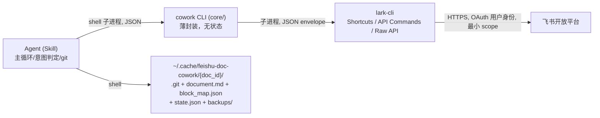

# feishu-doc-cowork

飞书文档 AI 协同编辑系统：Skill + `cowork` CLI。AI agent 轮询指定飞书 docx 文档的 **owner 评论**，判定修改意图后以**块级最小修改**在线编辑文档，每条评论对应**恰好一个 git commit**，回复评论并标记解决。设计规范见 [SPEC.md](SPEC.md)。

[English README](docs/README.en.md)

## 架构



- **lark-cli** 是唯一飞书通道（鉴权、分页、错误分类）；本系统不绕过它直调 API。
- **cowork CLI**（`core/`）只做适配：envelope 解析、错误归一化、入参校验、冲突检测；无业务逻辑。每个子命令 stdout 输出一个 JSON 对象，失败 exit 1 + `{"error":{code,message,lark_code,hint}}`。
- **Skill**（`skills/feishu-doc-cowork/SKILL.md`）承载主循环、意图判定、git 铁律。
- **git 目录**是审计与回滚基础设施；启动时做**纯本地备份**（保留 3 份）。

## 安装

### 前置（lark-cli 与授权）

需要 Node.js（装 lark-cli）、uv（Python 包管理）、git。

```bash
npm install -g @larksuite/cli
lark-cli config init          # 按提示绑定应用

# 精确授权（禁止 --recommend / --domain）
lark-cli auth login \
  --scope "docs:document.comment:read" \
  --scope "docs:document.comment:create" \
  --scope "docs:document.comment:update" \
  --scope "drive:drive.metadata:readonly" \
  --scope "docx:document:readonly" \
  --scope "docx:document" \
  --scope "board:whiteboard:node:read" \
  --scope "board:whiteboard:node:create" \
  --scope "board:whiteboard:node:delete"
```

### cowork（逻辑层 CLI）

```bash
uv tool install "git+https://github.com/JokeAliens/feishu-doc-cowork@v1.0.3#subdirectory=core"
cowork check-environment      # 自检：登录状态 + scope 覆盖
```

本地开发：`cd core && uv sync && uv run cowork ...`

### skill

```bash
npx skills add JokeAliens/feishu-doc-cowork        # 推荐：经 skills CLI 装入你的 agent
# 或手动：把 skills/feishu-doc-cowork/ 拷入 agent skills 目录

# 首次运行配置（生成默认 config.yaml；模型/Agent 署名由 agent 运行时自报，无需配置）
python <skills目录>/feishu-doc-cowork/scripts/config_init.py
```

## 最小权限 scope 清单

单一事实源：[`core/src/cowork_core/scopes.py`](core/src/cowork_core/scopes.py)；复核方法见 [`skills/feishu-doc-cowork/references/scope-checklist.md`](skills/feishu-doc-cowork/references/scope-checklist.md)。

| scope | 能力 | 复核 |
| --- | --- | --- |
| `docs:document.comment:read` | 读评论 | `lark-cli schema drive.file.comments.list` |
| `docs:document.comment:create` | 回复评论 | `lark-cli schema drive.file.comment.replys.create` |
| `docs:document.comment:update` | 解决（resolve）评论 | `lark-cli schema drive.file.comments.patch` |
| `drive:drive.metadata:readonly` | 文件元信息（owner） | `lark-cli schema drive.metas.batch_query` |
| `docx:document:readonly` | 读文档块 | `lark-cli auth check --scope "..."` |
| `docx:document` | 块级写文档 | 同上 |
| `board:whiteboard:node:read` / `:create` / `:delete` | 画板读写 | `lark-cli auth scopes --json` |

## 已知限制

1. 轮询制，评论感知延迟 = poll_interval（默认 10s）+ 处理耗时，非实时。
2. 画板编辑以 whiteboard DSL 覆盖面为准；无法表达的图元返回 `BOARD_UNSUPPORTED`，按 OUT_OF_SCOPE 静默跳过。
3. 旧版 `doc`（非 docx）无块级 API，启动检测并拒绝；wiki 链接自动解包。
4. 飞书 API 无协同感知（last-writer-wins）；**请尽量避免在 agent 处理时人工编辑同一文档**（冲突有 revision 检测兜底，重试 3 次后标记 failed）。
5. 评论「解决」后默认不再处理；owner 重新编辑已 done 的评论会触发重新处理。
6. 回复以用户本人身份发出，评论区显示"自己回复自己"，属预期（审计友好）。
7. 备份为纯本地快照（保留 3 份）；应用未启用文件删除 scope，不做云盘副本。

## License

[MIT](LICENSE)
