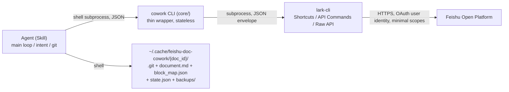

# feishu-doc-cowork

Comment-driven AI cowork editing for Feishu docs: a Skill + the `cowork` CLI. An AI agent polls **owner comments** on a given Feishu docx document, judges edit intent, applies **minimal block-level edits** online, produces **exactly one git commit per comment**, then replies and resolves the comment. See [SPEC.md](../SPEC.md) for the design spec (Chinese).

[中文 README](README.zh.md)

## Architecture



- **lark-cli** is the only channel to Feishu (auth, pagination, error classification); nothing bypasses it.
- **cowork CLI** (`core/`) is pure adaptation: envelope parsing, error normalization, input validation, conflict detection; no business logic. Every subcommand prints one JSON object on stdout; failures exit 1 with `{"error":{code,message,lark_code,hint}}`.
- **Skill** (`skills/feishu-doc-cowork/SKILL.md`) carries the main loop, intent judgement, and git rules.
- The **git directory** is the audit/rollback infrastructure; a **local-only backup** (keep 3) is taken at startup.

## Installation

### Prerequisites (lark-cli & authorization)

Requires Node.js (for lark-cli), uv (Python package manager), and git.

```bash
npm install -g @larksuite/cli
lark-cli config init          # bind the app as prompted

# Exact-scope authorization (never use --recommend / --domain)
lark-cli auth login \
  --scope "docs:document.comment:read" \
  --scope "docs:document.comment:create" \
  --scope "docs:document.comment:update" \
  --scope "drive:drive.metadata:readonly" \
  --scope "docx:document:readonly" \
  --scope "docx:document" \
  --scope "board:whiteboard:node:read" \
  --scope "board:whiteboard:node:create" \
  --scope "board:whiteboard:node:delete"
```

### cowork (logic-layer CLI)

```bash
uv tool install "git+https://github.com/JokeAliens/feishu-doc-cowork@v1.0.0#subdirectory=core"
cowork check-environment      # self-check: login status + scope coverage
```

Local development: `cd core && uv sync && uv run cowork ...`

### skill

```bash
npx skills add JokeAliens/feishu-doc-cowork        # recommended: installs via the skills CLI
# or manually: copy skills/feishu-doc-cowork/ into your agent's skills directory

# First-run configuration
python <skills-dir>/feishu-doc-cowork/scripts/config_init.py
# then edit identity.model_name / agent_name in ~/.cache/feishu-doc-cowork/config.yaml
```

## Minimal scope set

Single source of truth: [`core/src/cowork_core/scopes.py`](../core/src/cowork_core/scopes.py); verification commands in [`skills/feishu-doc-cowork/references/scope-checklist.md`](../skills/feishu-doc-cowork/references/scope-checklist.md).

| scope | capability | verify via |
| --- | --- | --- |
| `docs:document.comment:read` | read comments | `lark-cli schema drive.file.comments.list` |
| `docs:document.comment:create` | reply to comments | `lark-cli schema drive.file.comment.replys.create` |
| `docs:document.comment:update` | resolve comments | `lark-cli schema drive.file.comments.patch` |
| `drive:drive.metadata:readonly` | file metadata (owner) | `lark-cli schema drive.metas.batch_query` |
| `docx:document:readonly` | read document blocks | `lark-cli auth check --scope "..."` |
| `docx:document` | block-level writes | same |
| `board:whiteboard:node:read` / `:create` / `:delete` | whiteboard read/write | `lark-cli auth scopes --json` |

## Known limitations

1. Polling-based: comment detection latency = poll_interval (default 10s) + processing time; not real-time.
2. Whiteboard editing is limited to what the whiteboard DSL can express; unsupported primitives return `BOARD_UNSUPPORTED` and are silently skipped as OUT_OF_SCOPE.
3. Legacy `doc` (non-docx) documents have no block-level API and are rejected at startup; wiki links are unwrapped automatically.
4. The Feishu API has no collaboration awareness (last-writer-wins); **avoid editing the same document manually while the agent is processing** (revision conflict detection retries 3 times, then marks the comment failed).
5. Resolved comments are not processed again; if the owner edits an already-done comment, it is reprocessed.
6. Replies are posted as the authorized user, so they appear as "replying to yourself" in the comment thread — expected behavior (audit-friendly).
7. Backups are local-only snapshots (keep 3); the app has no file-deletion scope enabled, so no cloud-drive copies are made.

## License

[MIT](../LICENSE)
